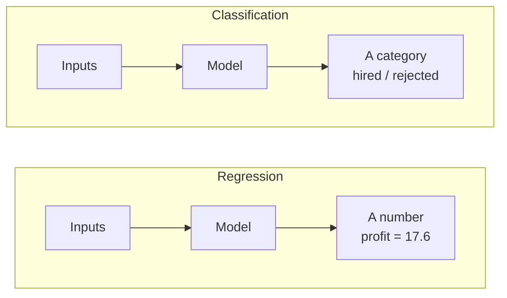
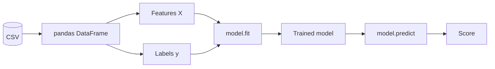
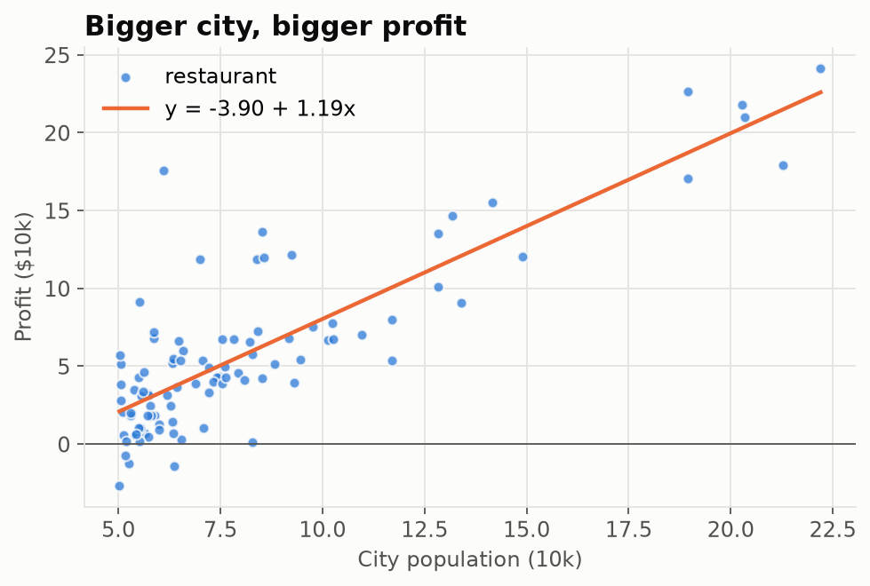
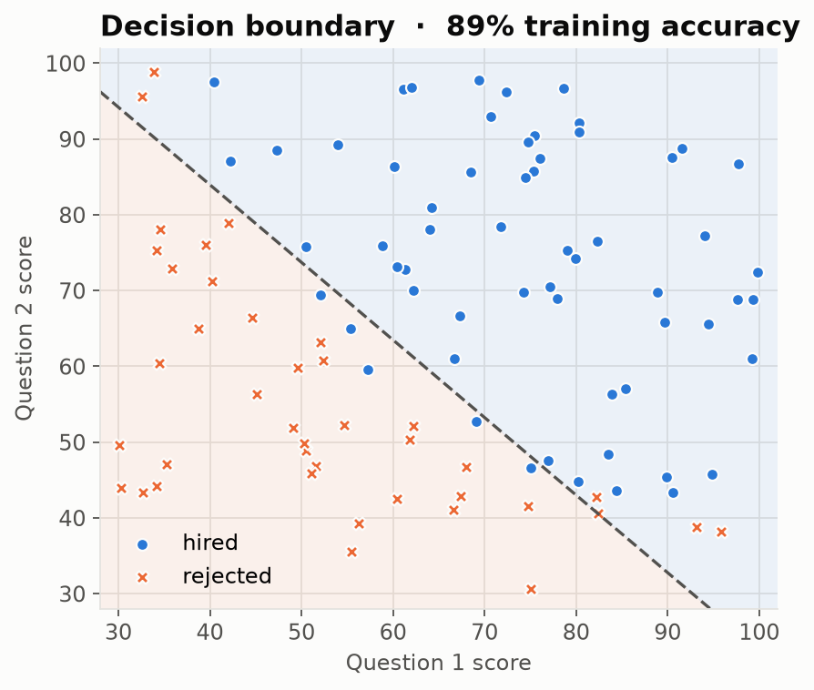
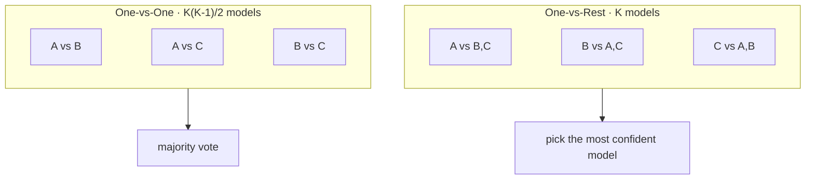
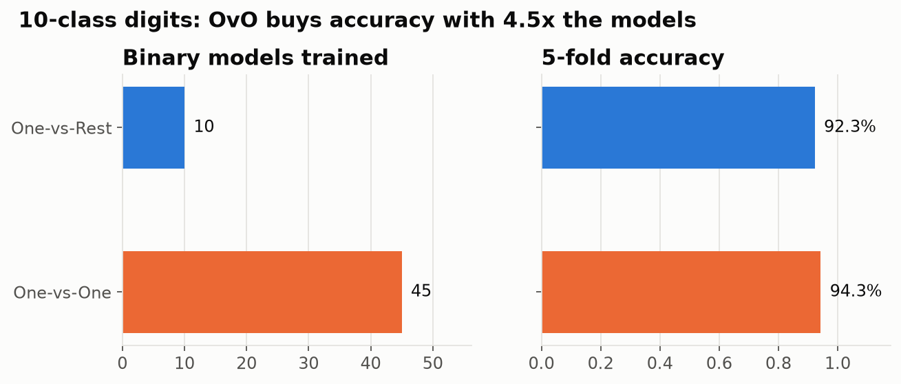

# Restaurant Profit & Hiring Regression

Teaching a computer to **predict a number** (restaurant profit), **make a yes/no call** (hire or reject), and stretch yes/no to **10 choices** (handwritten digits).
Explained for developers who have never touched ML. If you can write a function, you can follow this.

| 0.70 | 89% | 94% | 45 |
|:-:|:-:|:-:|:-:|
| R² of the profit line | hiring accuracy | best digit accuracy | models One-vs-One trains |

<sub>Data: restaurant and hiring sets from Andrew Ng's Machine Learning course [[1]](#references). Handwritten digits from the UCI repository [[2]](#references), bundled with scikit-learn.</sub>

---

## Regression vs classification in one picture

Both learn from examples. They differ in **what kind of answer** comes out.



## Translation table: ML words for developers

| ML term | What it means in dev terms |
|---|---|
| **Feature** | One input column |
| **Label / target** | The answer column you want to predict |
| **Regression** | Predict a `float` |
| **Classification** | Predict an `enum` |
| **Weight / coefficient** | How much one input moves the output |
| **Bias / intercept** | The output when every input is 0 |
| **Loss** | One number that scores how wrong the predictions are |
| **Decision boundary** | The line where the model switches its answer |
| **R²** | Share of the ups and downs the model explains (1 = perfect) |

## The whole workflow



In code, every model here looks like this:

```python
model = LinearRegression()          # 1. pick a model
model.fit(X, y)                     # 2. learn from examples
model.predict([[18]])               # 3. predict for a new input
model.score(X, y)                   # 4. how good is the fit?
```

---

## Core ideas

### 1. Linear regression: draw the best straight line

The model is a line. Training picks the slope and starting point.

```
profit = b₀ + b₁ · population
```

"Best" means the line with the **smallest total squared error**: square each point's vertical distance to the line, add them up, make that as small as possible.



> Both columns are in units of 10k. A city of 180,000 people predicts ≈ **$175.8k** profit.

### 2. Logistic regression: turn a line into a yes/no

A line gives any number, but "hire?" needs a probability between 0 and 1.
The **sigmoid** squashes any number into that range:

```
P(hired) = σ(b₀ + b₁ · score₁ + b₂ · score₂)        σ(z) = 1 / (1 + e⁻ᶻ)
```

Hire when the probability passes 0.5. The points where it equals exactly 0.5 form the **decision boundary**.



> The boundary is a straight line, so the 11 points on the wrong side are the cost of a linear model.

### 3. Many classes from yes/no models: One-vs-Rest vs One-vs-One

Logistic regression only answers yes/no. Two ways to stretch it to *K* classes:



| | One-vs-Rest | One-vs-One |
|---|---|---|
| Models for *K* classes | *K* | *K(K-1)/2* |
| Each model trains on | all data, imbalanced | two classes only, smaller |
| Prediction | highest score | most votes |



> For 10 digits, One-vs-One trains 45 models instead of 10 and gains 2 points of accuracy.

---

## Run it yourself

```bash
python3 -m venv .venv
source .venv/bin/activate
pip install pandas scikit-learn matplotlib
python restaurant_profit.py        # fit the profit line and plot it
python hiring_classifier.py        # fit the hiring classifier and plot its boundary
python multiclass_strategies.py    # compare One-vs-Rest and One-vs-One
python docs/make_figures.py        # regenerates every image in this README
```

Built with [pandas](https://pandas.pydata.org), [scikit-learn](https://scikit-learn.org) and [matplotlib](https://matplotlib.org).

## References

1. A. Ng, "Machine Learning," Stanford University, Coursera, 2011. Programming exercises 1 and 2.
2. E. Alpaydin and C. Kaynak, "Optical Recognition of Handwritten Digits," UCI Machine Learning Repository, 1998. https://doi.org/10.24432/C50P49
